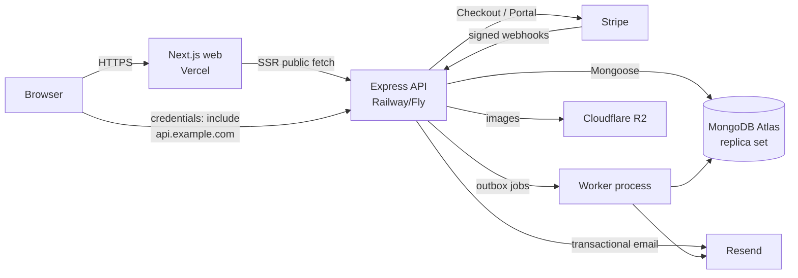

# 01 — Stack, Architecture and Layout

## Stack

| Layer | Choice | Why |
| --- | --- | --- |
| Language | TypeScript 5.x, strict | One language across web, API and shared contracts |
| Runtime | Node.js 22 LTS | Stable, native fetch, long support window |
| Package manager | npm 10 workspaces | Bundled with Node 22, zero extra tooling, simple workspace scripts |
| Web | Next.js (current stable, App Router) + React 19 | SSR/ISR marketing pages, server components, mature deploy story |
| Styling | Tailwind CSS 4 + shadcn/ui (Radix) | Fast design iteration, accessible primitives, own tokens |
| Client data | TanStack Query 5 | Cache, retries, mutations, loading/error states |
| Forms | React Hook Form + shared Zod schemas | One validation contract on both sides |
| API | Express 5 | Explicit middleware, easy RBAC/rate limits, decoupled from web |
| ODM | Mongoose 8+ | Schemas, indexes, transactions; Zod remains the boundary validator |
| Database | MongoDB 8 (Atlas prod, single-node replica set dev) | Document model fits sessions/bookings; transactions enabled by replica set |
| Auth | Better Auth + MongoDB adapter | Maintained session library, Express support, TOTP 2FA, OAuth |
| Billing | Stripe Checkout, Billing Portal, webhooks | Subscriptions, packs, drop-ins without custom card handling |
| Email | Resend + React Email, Mailpit locally | Transactional email with a local inbox |
| Files | Cloudflare R2 presigned uploads (Phase 4) | Class/coach images without passing bytes through the API |
| Validation | Zod 4 in `packages/shared` | Single source of truth for DTOs and OpenAPI |
| API docs | OpenAPI generated from Zod, Swagger UI in non-prod | Contract stays honest; CI checks drift |
| Tests | Vitest, Supertest, MongoMemoryReplSet, Playwright | Unit, API integration with real Mongo, critical E2E |
| Logging | pino + request IDs | Structured, redacted, production-friendly |
| Errors | Sentry (web + API) | Release tracking and alerting |
| Deploy | Vercel (web), Railway or Fly (API + worker), Atlas (DB) | Managed, low-ops, portable via Docker |

Versions are pinned at scaffold time and committed in `package-lock.json`. Do not
upgrade majors mid-phase.

## Architecture



- **Public pages** are rendered on the server and revalidated (ISR). The browser
  still hydrates the schedule filters and forms.
- **Member/dashboard data** is fetched client-side from the API with cookies.
  This keeps one authorization path and avoids leaking member data into RSC
  payloads.
- **Web and API use custom domains on the same site** (`app.example.com`,
  `api.example.com`) so session cookies are first-party and `SameSite=Lax`
  works. Vercel/Railway preview hostnames are for previews only; auth is tested
  on custom domains.
- **API is the only trusted boundary.** The web app may hide UI by role, but
  every action is authorized again on Express.

## App map

### Public — `(marketing)`

| Route | Rendering | Content |
| --- | --- | --- |
| `/` | RSC + ISR 5 min | Hero, marquee, stats, facility, why, testimonials, CTA |
| `/classes` | RSC shell + client filters | Next 14 days of sessions, capacity, waitlist state |
| `/membership` | RSC + ISR 1 h | Plans, packs, FAQ, checkout CTAs |
| `/coaches` | RSC + ISR 1 h | Coach profiles from active `coachProfiles` |
| `/contact` | RSC + form | Address, hours, contact form |
| `/free-week` | RSC + form | Lead capture (name, email, phone, goal) |
| `/privacy`, `/terms` | RSC | Placeholder legal copy before launch |

### Auth — `(auth)`

`/login`, `/signup`, `/verify-email`, `/forgot-password`, `/reset-password`,
`/accept-invite?token=…`, `/auth/callback` (OAuth handled by API).

### Member — `(member)/account`

| Route | Purpose |
| --- | --- |
| `/account` | Overview: next booking, membership, credits, notifications |
| `/account/bookings` | Upcoming/past, waitlist position, cancel |
| `/account/membership` | Plan, renewal, status, billing portal button |
| `/account/credits` | Pack balances, ledger, expiry |
| `/account/settings` | Name, phone, password, sessions, 2FA (optional) |

### Staff — `(dashboard)/dashboard`

| Route | Roles | Purpose |
| --- | --- | --- |
| `/dashboard` | coach, admin, superadmin | Today's sessions, occupancy, quick links |
| `/dashboard/schedule` | admin, superadmin | Week view, create/edit/cancel sessions |
| `/dashboard/classes` | admin, superadmin | Class templates and recurring rules |
| `/dashboard/roster/[sessionId]` | coach (own), admin, superadmin | Bookings, waitlist, attendance |
| `/dashboard/members` | admin, superadmin | Search, status, plan, credits |
| `/dashboard/members/[id]` | admin, superadmin | Profile, history, adjustments |
| `/dashboard/leads` | admin, superadmin | Free-week and contact leads |
| `/dashboard/coaches` | admin, superadmin | Coach profiles + coach invites |
| `/dashboard/billing` | superadmin | Plans, prices, payments, reconciliation |
| `/dashboard/team` | superadmin | Admin invites, roles, suspension |
| `/dashboard/audit` | superadmin | Filter/export audit log |
| `/dashboard/settings` | superadmin | Booking rules, timezone, email settings |

The dashboard shell renders navigation by role, but route access is enforced by
the API. A coach hitting `/dashboard/team` sees a 403 page, not data.

## Repository layout

```
gym/
├─ frontend/
│  ├─ app/
│  │  ├─ (marketing)/…
│  │  ├─ (auth)/…
│  │  ├─ (member)/account/…
│  │  ├─ (dashboard)/dashboard/…
│  │  ├─ layout.tsx  globals.css  not-found.tsx  error.tsx
│  ├─ components/{ui,marketing,booking,dashboard,forms}/
│  ├─ lib/{api,auth,query,format,time,seo}/
│  ├─ hooks/
│  ├─ public/{images,video}/
│  ├─ next.config.ts  tailwind.config.ts  tsconfig.json  package.json
├─ backend/
│  ├─ src/
│  │  ├─ index.ts  app.ts  worker.ts
│  │  ├─ config/{env,db,logger,stripe,mailer,betterAuth}.ts
│  │  ├─ modules/
│  │  │  ├─ auth/        better-auth config, routes, invites, 2fa guard
│  │  │  ├─ users/       profile, admin user queries
│  │  │  ├─ classes/     templates, sessions, generator
│  │  │  ├─ bookings/    booking, waitlist, cancellation, attendance
│  │  │  ├─ billing/     checkout, portal, webhooks, plans, credits
│  │  │  ├─ members/     admin member management
│  │  │  ├─ coaches/     profiles, coach invites
│  │  │  ├─ leads/       free-week + contact
│  │  │  ├─ dashboard/   overview, audit, settings
│  │  │  ├─ notifications/
│  │  │  └─ checkins/    stretch
│  │  ├─ shared/         errors, middleware, policies, pagination,
│  │  │                  idempotency, transactions, time
│  │  ├─ db/             models, index definitions
│  │  ├─ jobs/           outbox, session generator, reconcile
│  │  └─ scripts/        seed, seed-superadmin, stripe-plans, reset-2fa
│  ├─ migrations/        migrate-mongo
│  ├─ tests/{unit,integration}/
│  ├─ Dockerfile  migrate-mongo-config.js  package.json  tsconfig.json
├─ packages/shared/
│  ├─ src/{schemas,types,constants,permissions,time}/  index.ts
│  ├─ package.json  tsconfig.json
├─ e2e/                  Playwright specs + fixtures
├─ docs/plan/            this plan + prompts
├─ docker-compose.yml
├─ package-lock.json
├─ package.json
├─ .env.example
├─ AGENTS.md
```

No Turborepo: root scripts orchestrate `@gym/shared`, `@gym/api` and
`@gym/web`. Add Turborepo only if build orchestration becomes a bottleneck.

## Package boundaries

| Package | May import | Must never import |
| --- | --- | --- |
| `@gym/shared` | Zod, pure TS utilities | Node APIs, React, Mongoose, Stripe, Express |
| `@gym/api` | shared, Node/Express/Mongoose/Stripe | frontend |
| `@gym/web` | shared, React/Next | backend, Mongoose, Stripe secret SDK |

`@gym/shared` exports Zod schemas and inferred types, role/permission constants,
pagination helpers, booking constants and time utilities. It is built with
`tsup` for production and watched in dev; Next.js uses `transpilePackages`.

## Local topology

| Service | Port | Notes |
| --- | --- | --- |
| Next.js | 3000 | `http://localhost:3000` |
| Express API | 4000 | `http://localhost:4000`, `/api/health` |
| Worker | — | Outbox/session generator; `npm run worker:dev -w @gym/api` |
| MongoDB | 27017 | Single-node replica set `rs0`, transactions enabled |
| Mailpit SMTP/UI | 1025 / 8025 | Catches all dev email |
| Stripe CLI | — | `stripe listen --forward-to localhost:4000/api/webhooks/stripe` |

Local web and API are same-site (`localhost`), so cookies work without
`SameSite=None`. Use `credentials: "include"` and an exact CORS allowlist.

## Environments

| Env | Web | API | DB | Stripe | Email |
| --- | --- | --- | --- | --- | --- |
| Local | Next dev | tsx watch | Docker replica set | Test + CLI | Mailpit |
| Preview | Vercel preview | Railway preview | Atlas dev | Test | Resend test |
| Production | Vercel custom domain | Railway/Fly custom domain | Atlas M10+ | Live | Resend verified domain |

Config is validated at boot with Zod. Backend secrets never appear in
`NEXT_PUBLIC_*`. Required production variables are listed in
`06-testing-and-operations.md`.

## Deploy topology

- **Web:** Vercel, custom domain `app.example.com` (or apex + `www`). Build
  `npm run build -w @gym/web`. Env: `NEXT_PUBLIC_API_URL`,
  `NEXT_PUBLIC_SITE_URL`.
- **API:** Railway/Fly, Dockerfile from `backend/`, health check `/api/health`,
  release command runs migrations, min 1 instance.
- **Worker:** same image, `npm run start:worker -w @gym/api`, exactly one
  replica. Prevents duplicate outbox sends.
- **DB:** Atlas M10+ (backups, transactions), IP allowlist for API egress,
  separate dev/prod projects.
- **Cookies:** `Domain=.example.com`, `Secure`, `HttpOnly`, `SameSite=Lax`;
  CORS allowlist `https://app.example.com`.
- **OAuth:** Google callback `https://api.example.com/api/auth/callback/google`.
- **Webhooks:** `https://api.example.com/api/webhooks/stripe`, raw body,
  signature verification.

## Key architecture decisions

1. **Separate folders, shared contracts.** The user asked for `frontend/` and
   `backend/`; we keep them deployable independently and share only Zod/types.
2. **No Next.js route handlers for domain logic.** Express owns auth, booking,
   billing and RBAC. Next.js only proxies public reads for SSR and serves UI.
3. **No JWT in localStorage.** Better Auth session cookies, httpOnly.
4. **No client prices.** Checkout accepts IDs; Stripe prices are resolved on
   the server from `membershipPlans` / `packProducts`.
5. **SSR marketing, client portal.** SEO for public pages; authenticated data
   stays out of server-rendered HTML.
6. **MongoDB transactions are mandatory.** Dev uses a replica set; tests use
   `MongoMemoryReplSet`; production uses Atlas.
7. **One location, `locationId` everywhere.** No multi-location UI, but no
   migration later.
8. **Boring infrastructure.** Vercel + Railway + Atlas; Docker for portability.

## Version policy

- Pin Node (`engines`), npm (`packageManager`) and all dependencies.
- Renovate/Dependabot monthly, not mid-phase.
- Security patches may land between phases with a changelog note.
- Do not upgrade Next.js, Express, Mongoose, Better Auth or Stripe majors in a
  feature phase.
