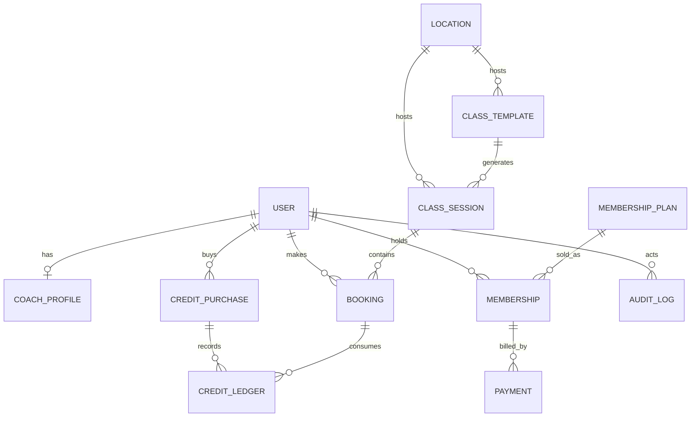
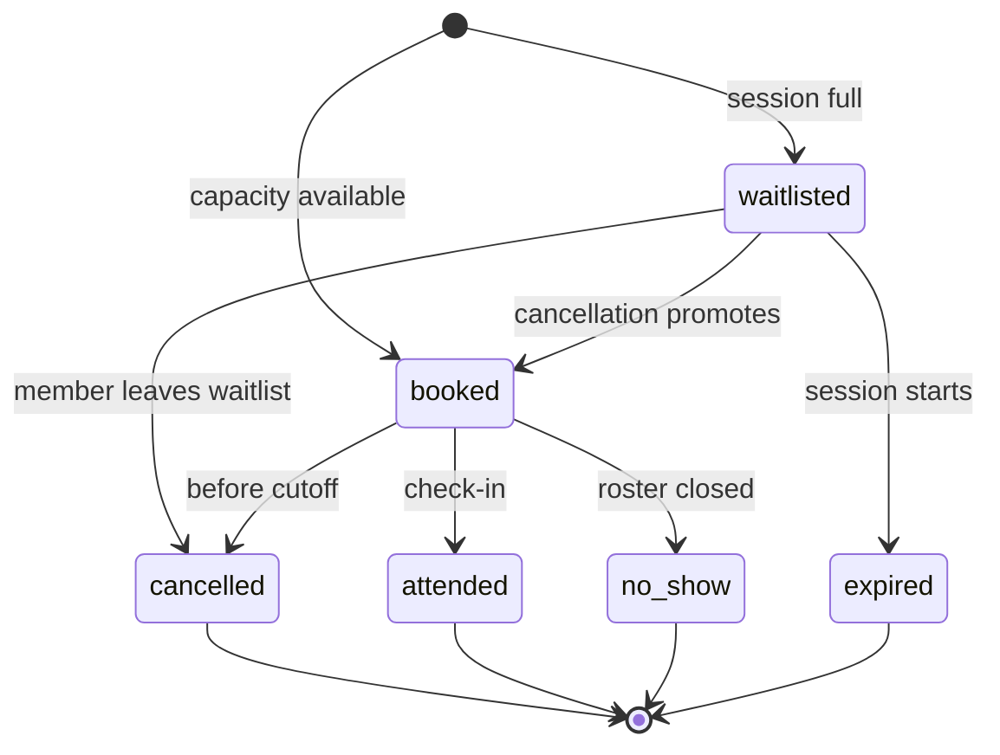

# 02 — Domain Model

## Modelling principles

- **Reference, don't embed, unbounded data.** Bookings are a collection, never
  an array on a session. Plan features and opening hours are small, bounded
  value objects and may be embedded.
- **Snapshot what history needs.** A session copies the template's title, coach
  and time at generation. Editing a template later must not rewrite past
  sessions. Bookings store `sessionStartsAt` for fast "my bookings" queries.
- **Money is integer cents.** Credits are integers. Never floats.
- **Instants are UTC; presentation is location time.** Every session stores
  `startsAt`/`endsAt` as UTC and the IANA `timezone`; `localDate` and
  `localStartTime` are denormalized for admin views and debugging.
- **Denormalized counters are caches.** `bookedCount` and `waitlistCount` are
  maintained in transactions and reconciled nightly. The source of truth is
  the `bookings` collection.
- **Mongo transactions require a replica set.** Dev uses a single-node replica
  set; tests use `MongoMemoryReplSet`; production uses Atlas.
- **Every location-scoped document carries `locationId`.** One active location
  in v1, but the field is mandatory from day one.
- **Soft state, not hard deletes.** Cancel/archive rather than delete. Audit
  logs and payment records are append-only.

## Entity relationship (simplified)



## Collections

### `users`

Auth-owned fields (Better Auth) plus app fields.

| Field | Type | Notes |
| --- | --- | --- |
| `_id` | ObjectId | |
| `email` | string | lowercase, unique |
| `emailVerified` | boolean | required before booking |
| `name` | string | |
| `image` | string? | avatar URL |
| `role` | enum | `superadmin`, `admin`, `coach`, `member` |
| `status` | enum | `active`, `suspended`, `invited` |
| `phone` | string? | E.164-ish, optional |
| `mustChangePassword` | boolean | seeded superadmin / reset flows |
| `twoFactorEnabled` | boolean | required for privileged roles |
| `lastLoginAt` | Date? | |
| `createdAt`, `updatedAt` | Date | |

Indexes: `{email:1}` unique (Better Auth), `{role:1,status:1}`.

Better Auth owns `session`, `account`, `verification` and 2FA secret storage;
configure its model names to avoid collisions. Application code reads the user
via the auth session, never trusts a client-supplied role.

### `adminInvites`

| Field | Type | Notes |
| --- | --- | --- |
| `email` | string | lowercase, bound to the invite |
| `role` | enum | `admin` or `coach` (superadmin invites only admins) |
| `tokenHash` | string | SHA-256 of a 32-byte random token; never store plaintext |
| `status` | enum | `pending`, `accepted`, `revoked`, `expired` |
| `invitedBy` | ObjectId | superadmin/admin |
| `expiresAt` | Date | 48 hours |
| `acceptedAt` | Date? | |
| `createdAt` | Date | |

Indexes: `{tokenHash:1}` unique, `{email:1,status:1}`, `{expiresAt:1}`.
Single-use: accept flips `pending → accepted` atomically; a second attempt
returns 410. Revoking or re-inviting invalidates previous pending invites.

### `locations`

| Field | Type | Notes |
| --- | --- | --- |
| `name`, `slug` | string | slug unique |
| `timezone` | string | IANA, e.g. `America/Los_Angeles` |
| `address` | object | line1, line2?, city, region, postalCode, country |
| `phone`, `email` | string | |
| `openingHours` | array | embedded `{day, opens, closes}` |
| `floorCapacity` | number | occupancy stretch goal |
| `active` | boolean | exactly one active in v1 |

Index: `{slug:1}` unique. Seed one location; no UI to add more.

### `coachProfiles`

| Field | Type | Notes |
| --- | --- | --- |
| `userId` | ObjectId | unique, role must be `coach` |
| `headline` | string | e.g. "Head Coach · Strength" |
| `bio` | string | public |
| `credentials` | string[] | embedded, bounded |
| `specialties` | string[] | strength, conditioning, boxing, mobility |
| `photoUrl` | string? | R2/CDN |
| `displayOrder` | number | |
| `active` | boolean | public visibility |

Indexes: `{userId:1}` unique, `{active:1,displayOrder:1}`. Public `/coaches`
reads only active profiles and joins the user's name/image.

### `classTemplates`

| Field | Type | Notes |
| --- | --- | --- |
| `locationId` | ObjectId | required |
| `title`, `slug`, `description` | string | slug unique per location |
| `discipline` | enum | `strength`, `conditioning`, `boxing`, `mobility`, `recovery` |
| `level` | enum | `all`, `beginner`, `intermediate`, `advanced` |
| `coachId` | ObjectId | user with role coach |
| `durationMinutes` | number | 30–120 |
| `capacity` | number | default 16, 1–60 |
| `recurrence` | object | embedded; see below |
| `imageUrl` | string? | |
| `active` | boolean | archive instead of delete |
| `createdBy` | ObjectId | admin/superadmin |
| `createdAt`, `updatedAt` | Date | |

`recurrence`:
```
{
  daysOfWeek: [1,3,5],        // ISO: 1=Mon … 7=Sun
  startTime: "06:30",         // local wall time
  startsOn: "2026-11-02",     // local date
  endsOn: "2027-11-02" | null,
  exceptions: ["2026-12-25"]  // local dates to skip
}
```
Indexes: `{locationId:1,active:1}`, `{coachId:1,active:1}`,
`{locationId:1,slug:1}` unique.

The template is a **rule**, not a bookable thing. Editing it never mutates
already-generated sessions; the admin can regenerate future sessions.

### `classSessions`

| Field | Type | Notes |
| --- | --- | --- |
| `templateId` | ObjectId? | null for one-offs |
| `locationId` | ObjectId | |
| `title`, `coachName` | string | snapshot |
| `coachId` | ObjectId | |
| `discipline`, `level` | enum | snapshot |
| `startsAt`, `endsAt` | Date | UTC |
| `timezone` | string | IANA at generation |
| `localDate` | string | `YYYY-MM-DD`, gym time |
| `localStartTime` | string | `HH:mm`, gym time |
| `capacity` | number | can be raised by admin |
| `bookedCount` | number | cache, `>= 0` |
| `waitlistCount` | number | cache, `>= 0` |
| `status` | enum | `scheduled`, `cancelled`, `completed` |
| `cancellationReason` | string? | |
| `createdAt`, `updatedAt` | Date | |

Indexes:
- `{startsAt:1,status:1}`
- `{locationId:1,startsAt:1}`
- `{coachId:1,startsAt:1}`
- `{templateId:1,startsAt:1}` unique, partial `{templateId:{$exists:true}}`

Generation is idempotent: the unique template/start index makes a rerun a
no-op. The generator runs nightly and creates 8 weeks ahead (configurable),
using the location timezone and DST-safe arithmetic. Admins can cancel or edit
one session without touching the template.

### `bookings`

One document covers booked, waitlisted and terminal states. This keeps member
history and waitlist ordering in one place.

| Field | Type | Notes |
| --- | --- | --- |
| `sessionId` | ObjectId | |
| `memberId` | ObjectId | user with role member (staff may book manually) |
| `status` | enum | `booked`, `waitlisted`, `cancelled`, `attended`, `no_show`, `expired` |
| `active` | boolean | true only for `booked`/`waitlisted`; drives unique index |
| `sessionStartsAt` | Date | snapshot for sorting "my bookings" |
| `source` | enum | `web`, `admin`, `waitlist_promotion` |
| `creditPurchaseId` | ObjectId? | set when a pack credit is consumed |
| `bookedAt`, `cancelledAt`, `promotedAt` | Date? | |
| `promotionGraceUntil` | Date? | late-promotion cancel window |
| `cancellationReason` | string? | |
| `checkedInAt` | Date? | attendance |
| `markedBy` | ObjectId? | staff who recorded attendance |

Indexes:
- `{sessionId:1,memberId:1}` unique, partial `{active:true}` — one active
  booking/waitlist entry per member per session.
- `{sessionId:1,status:1,createdAt:1}` — roster and waitlist order.
- `{memberId:1,sessionStartsAt:-1}` — member history.
- `{status:1,sessionStartsAt:1}` — jobs and reminders.

State machine:



Promotion is a `waitlisted → booked` transition on the same document, recorded
by `promotedAt` and `source: "waitlist_promotion"`. If a promoted member
cancels inside `promotionGraceUntil`, the credit is restored and the next
waitlisted member is promoted.

### `membershipPlans`

| Field | Type | Notes |
| --- | --- | --- |
| `slug` | string | unique, e.g. `unlimited` |
| `name`, `description` | string | public |
| `priceCents`, `currency` | number/string | display; Stripe is authoritative |
| `interval` | enum | `month`, `year` |
| `stripeProductId`, `stripePriceId` | string | server-side only |
| `classAccess` | enum | `none`, `unlimited` |
| `monthlyClassCredits` | number? | for future credit-based plans |
| `includesPrivateSessions` | number | display + manual fulfilment |
| `features` | string[] | embedded, bounded |
| `trialDays` | number | 0 in v1 (free week is a lead) |
| `active`, `displayOrder` | boolean/number | |
| `createdAt`, `updatedAt` | Date | |

Indexes: `{slug:1}` unique, `{active:1,displayOrder:1}`.

Seed plans (prices illustrative, confirm before launch):
- **Floor Access** — $79/mo, `classAccess: none`, open gym + recovery.
- **Unlimited** — $149/mo, `classAccess: unlimited`, all classes.
- **Private Coaching** — $289/mo, unlimited classes + 4 private sessions
  fulfilled manually by a coach in v1.

Price changes create a **new** Stripe Price and archive the old one; existing
subscriptions keep their price. Never mutate a Stripe Price in place.

### `memberships`

| Field | Type | Notes |
| --- | --- | --- |
| `memberId` | ObjectId | |
| `planId` | ObjectId | |
| `status` | enum | `trialing`, `active`, `past_due`, `canceled`, `paused`, `incomplete`, `expired` |
| `current` | boolean | one current membership per member |
| `stripeCustomerId`, `stripeSubscriptionId` | string | subscription id unique sparse |
| `currentPeriodStart`, `currentPeriodEnd` | Date | |
| `accessUntil` | Date | access can outlive cancellation to period end |
| `cancelAtPeriodEnd` | boolean | |
| `startedAt`, `endedAt` | Date? | |
| `createdAt`, `updatedAt` | Date | |

Indexes:
- `{memberId:1}` unique, partial `{current:true}`.
- `{stripeSubscriptionId:1}` unique, sparse.
- `{status:1,currentPeriodEnd:1}`.

Entitlement uses `accessUntil > now` and a status allowlist, not just
`status === "active"`. `past_due` gets a configurable 3-day grace, then class
booking is blocked but the billing portal remains available. Cancellation at
period end sets `cancelAtPeriodEnd: true`; access continues until
`currentPeriodEnd`, then a job/webhook sets `current: false`.

### `creditPurchases`

A purchased pack or drop-in. Credits are money-like; the ledger is the audit
trail.

| Field | Type | Notes |
| --- | --- | --- |
| `memberId` | ObjectId | |
| `type` | enum | `pack`, `drop_in`, `admin_grant`, `promo` |
| `label` | string | e.g. "10-class pack" |
| `creditsTotal`, `creditsRemaining` | number | integers |
| `priceCents` | number | 0 for grants/promos |
| `stripeCheckoutSessionId`, `stripePaymentIntentId` | string? | unique sparse |
| `status` | enum | `active`, `exhausted`, `expired`, `refunded` |
| `purchasedAt`, `expiresAt` | Date | packs expire in 6 months |
| `createdAt`, `updatedAt` | Date | |

Indexes: `{memberId:1,status:1,expiresAt:1}`,
`{stripeCheckoutSessionId:1}` unique sparse,
`{stripePaymentIntentId:1}` unique sparse.

Consumption order: earliest expiry first, then oldest purchase. Unlimited
memberships do not consume credits. A member can hold multiple packs.

### `creditLedger`

Append-only. Every grant, consumption, restoration, expiry, refund and admin
adjustment writes one row.

| Field | Type | Notes |
| --- | --- | --- |
| `memberId`, `creditPurchaseId` | ObjectId | |
| `delta` | number | negative consumes, positive grants |
| `balanceAfter` | number | for support/debugging |
| `reason` | enum | `purchase`, `booking`, `cancellation`, `promotion_grace`, `expiry`, `refund`, `admin_adjustment` |
| `bookingId` | ObjectId? | |
| `actorId` | ObjectId? | member or staff |
| `note` | string? | admin adjustment reason |
| `createdAt` | Date | |

Indexes: `{memberId:1,createdAt:-1}`, `{creditPurchaseId:1}`,
`{bookingId:1,reason:1}` unique partial `{bookingId:{$exists:true}}` — prevents
charging the same booking twice. No update/delete routes.

### `payments`

Local mirror of Stripe payments for admin views and reconciliation.

| Field | Type | Notes |
| --- | --- | --- |
| `memberId` | ObjectId? | nullable for unmatched events |
| `type` | enum | `subscription`, `pack`, `drop_in`, `refund` |
| `stripeCheckoutSessionId`, `stripePaymentIntentId`, `stripeInvoiceId` | string? | unique sparse each |
| `amountCents`, `currency` | number/string | |
| `status` | enum | `pending`, `paid`, `failed`, `refunded`, `partially_refunded` |
| `description` | string | |
| `metadata` | object | bounded; no card data |
| `createdAt`, `updatedAt` | Date | |

Indexes: `{memberId:1,createdAt:-1}`, unique sparse on each Stripe id,
`{status:1,createdAt:1}`.

### `stripeEvents`

Webhook inbox and idempotency guard.

| Field | Type | Notes |
| --- | --- | --- |
| `eventId` | string | Stripe `evt_…`, unique |
| `type` | string | |
| `apiVersion` | string? | |
| `payload` | object | raw event JSON, bounded |
| `status` | enum | `received`, `processing`, `processed`, `failed`, `ignored` |
| `attempts` | number | |
| `lockedAt`, `processedAt` | Date? | stale-lock recovery |
| `lastError` | string? | redacted |
| `createdAt` | Date | |

Indexes: `{eventId:1}` unique, `{status:1,createdAt:1}`. Duplicate event →
200 immediately. Failed events are retried; `processed` events are never
reprocessed. Payloads contain PII; restrict access and set a retention policy
(e.g. 90 days) after reconciliation.

### `outboxEvents`

Transactional outbox for email and in-app notifications. The API writes it in
the same transaction as the business change; a single worker sends it.

| Field | Type | Notes |
| --- | --- | --- |
| `type` | enum | `email`, `notification` |
| `template` | string | e.g. `booking-confirmed` |
| `recipient` | string | email or userId |
| `payload` | object | template data |
| `status` | enum | `pending`, `processing`, `sent`, `failed` |
| `attempts`, `availableAt` | number/Date | exponential backoff |
| `lockedAt`, `sentAt` | Date? | |
| `lastError` | string? | |
| `createdAt` | Date | |

Indexes: `{status:1,availableAt:1}`, `{createdAt:1}` with TTL 30 days for
sent rows. The worker claims rows atomically, sends via Resend, and marks
sent/failed. One worker replica only.

### `auditLogs`

Append-only record of privileged actions and security events.

| Field | Type | Notes |
| --- | --- | --- |
| `actorId` | ObjectId? | null for system/seed |
| `actorRole` | enum? | role at the time |
| `action` | string | e.g. `admin.role.changed`, `class_session.cancelled` |
| `entityType`, `entityId` | string/ObjectId | |
| `before`, `after` | object? | redacted snapshots |
| `ip`, `userAgent`, `requestId` | string? | |
| `metadata` | object? | small, no secrets |
| `createdAt` | Date | |

Indexes: `{createdAt:-1}`, `{actorId:1,createdAt:-1}`,
`{entityType:1,entityId:1,createdAt:-1}`, `{action:1,createdAt:-1}`.
No update/delete route. Optionally deny updates/deletes at the DB user level.
Retention: at least 1 year; export before purge.

### `leads`

Free-week requests and other marketing leads.

| Field | Type | Notes |
| --- | --- | --- |
| `name`, `email`, `phone` | string | phone optional |
| `goal` | string? | |
| `source` | enum | `free_week`, `contact`, `drop_in`, `other` |
| `status` | enum | `new`, `contacted`, `tour_booked`, `converted`, `lost`, `archived` |
| `assignedTo` | ObjectId? | admin |
| `notes` | array | embedded `{body, authorId, createdAt}`, bounded |
| `createdAt`, `updatedAt` | Date | |

Indexes: `{status:1,createdAt:-1}`, `{email:1}`, `{source:1,createdAt:-1}`.
Public create is rate-limited + honeypot/Turnstile. Admin updates are audited.

### `contactMessages`

Separate from leads because it is a support inbox, not a sales pipeline.

Fields: `name`, `email`, `phone?`, `message`, `status`
(`new`, `read`, `replied`, `archived`), `handledBy`, `createdAt`, `updatedAt`.
Index `{status:1,createdAt:-1}`.

### `notifications`

In-app notifications for members and staff.

Fields: `userId`, `type`, `title`, `body`, `link?`, `readAt?`, `createdAt`.
Index `{userId:1,readAt:1,createdAt:-1}`. Created via the outbox in the same
transaction as the triggering event.

### `systemSettings`

Singleton document (`_id: "system"`) with business rules, editable only by a
superadmin and always audited.

```
{
  bookingCutoffHours: 12,
  bookingWindowDays: 14,
  scheduleHorizonWeeks: 8,
  waitlistEnabled: true,
  maxUpcomingBookings: 8,
  pastDueGraceDays: 3,
  promotionGraceHours: 2,
  supportEmail: "hello@example.com",
  fromEmail: "train@example.com",
  updatedBy, updatedAt
}
```
Secrets (Stripe keys, auth secret, Mongo URI) stay in environment variables,
never here.

### `idempotencyKeys`

For money/booking mutations that could be retried by the client.

Fields: `key`, `userId`, `route`, `requestHash`, `status`
(`processing`, `completed`), `responseStatus`, `responseBody`, `createdAt`,
`expiresAt`. Unique `{key:1,userId:1,route:1}`; TTL 24 hours. A replay with the
same key and body returns the stored response; a different body returns 422.

### `checkIns` (Phase 5 stretch)

Fields: `memberId`, `locationId`, `sessionId?`, `checkedInAt`, `checkedOutAt?`,
`method` (`qr`, `manual`), `actorId?`. Indexes:
`{locationId:1,checkedOutAt:1}`, `{memberId:1,checkedInAt:-1}`.
Live occupancy = active check-ins; use a cached counter on `locations` with
atomic increments and a nightly reconcile.

## Business rules

### Booking window and limits

- Members can book from `now` through `bookingWindowDays` (default 14).
- `maxUpcomingBookings` (default 8) counts `booked` + `waitlisted` future
  sessions, across all dates. Staff bookings bypass the cap but are audited.
- Booking closes at `startsAt`; sessions already started cannot be booked.
- A member with no entitlement may still join a waitlist? **No.** Waitlist is
  an entitlement-bearing action; require a valid membership or credit first.
- One active booking **or** waitlist entry per member per session, enforced by
  the partial unique index.

### Booking algorithm (must be transactional)

```
withTransaction(async (mongoSession) => {
  const member = await loadActiveMember(memberId, mongoSession)
  const entitlement = await resolveEntitlement(member, mongoSession)
  if (!entitlement.allowed) throw new AppError("NO_ENTITLEMENT", 403)

  // Conditional capacity reservation: atomic; no count-then-insert.
  const session = await ClassSession.findOneAndUpdate(
    { _id: sessionId, status: "scheduled",
      $expr: { $lt: ["$bookedCount", "$capacity"] } },
    { $inc: { bookedCount: 1 } },
    { new: true, session: mongoSession }
  )

  if (session) {
    if (entitlement.source === "credit") {
      await consumeCredit(entitlement.creditPurchaseId, mongoSession)
    }
    await Booking.create([{
      sessionId, memberId, status: "booked", active: true,
      sessionStartsAt: session.startsAt, source: "web",
      creditPurchaseId: entitlement.creditPurchaseId ?? null
    }], { session: mongoSession })
    await enqueueOutbox("booking-confirmed", ..., mongoSession)
    return { status: "booked", session }
  }

  // Full (or cancelled/not found): distinguish before waitlisting.
  const current = await ClassSession.findById(sessionId).session(mongoSession)
  if (!current || current.status !== "scheduled") throw new AppError("SESSION_UNAVAILABLE", 409)
  if (!settings.waitlistEnabled) throw new AppError("SESSION_FULL", 409)

  await ClassSession.updateOne(
    { _id: sessionId, status: "scheduled" },
    { $inc: { waitlistCount: 1 } },
    { session: mongoSession }
  )
  await Booking.create([{
    sessionId, memberId, status: "waitlisted", active: true,
    sessionStartsAt: current.startsAt, source: "web"
  }], { session: mongoSession })
  return { status: "waitlisted", position: ... }
})
```

The unique partial index on `{sessionId, memberId, active:true}` turns a
concurrent duplicate into a duplicate-key error → `409 ALREADY_BOOKED`. The
whole transaction retries on `TransientTransactionError` (max 3 attempts).

**Do not** decrement credits before capacity is reserved. **Do not** use
`countDocuments()` to decide capacity. **Do not** insert the booking before
the counter update.

### Cancellation

- Members may cancel before `startsAt - bookingCutoffHours` (default 12h).
- Cancelling a **waitlist** entry is always allowed before the session starts;
  decrement `waitlistCount`, set `cancelled`, no cutoff.
- Staff may cancel on behalf of a member at any time; reason required; audited.
- On time: status `cancelled`, `active:false`, decrement `bookedCount`, restore
  the pack credit if one was consumed, promote the oldest waitlisted member.
- Late: same state change, but **no credit restoration**. This is not a fee;
  the session is consumed. Unlimited members are unaffected.
- After the session starts, members cannot cancel; staff mark `attended` or
  `no_show`.
- Session cancelled by the gym: all active bookings → `cancelled`, all credits
  restored, waitlist cleared with `expired`, and everyone emailed. Counters
  reset to zero. Audited.

### Waitlist and promotion

- Ordered by `createdAt` then `_id` (stable tiebreaker). Position =
  count of earlier active waitlist entries + 1.
- When a spot opens, promote the oldest entry in the **same transaction**:
  set `status:"booked"`, `promotedAt`, `source:"waitlist_promotion"`,
  decrement `waitlistCount`, increment `bookedCount`. If the conditional
  counter update fails, leave the entry waitlisted; the next cancellation
  retries.
- Promotion consumes a credit at promotion time, not at waitlist join. If the
  member has no credit anymore, skip to the next entry and notify them.
- If promotion happens inside the 12h cutoff, set
  `promotionGraceUntil = now + promotionGraceHours` (default 2). Cancelling
  before that instant restores the credit and promotes the next person.
- Email + in-app notification on join, promotion, and expiry.

### Entitlement

```
active membership (current=true, accessUntil > now, status in
  trialing/active/past_due within grace)
  → classAccess "unlimited": allowed, source membership
  → classAccess "none": fall through to credits
otherwise/also:
  oldest unexpired creditPurchase with creditsRemaining > 0
  → allowed, source credit
else → 403 NO_ENTITLEMENT
```

- `past_due` keeps access for `pastDueGraceDays` (3), then blocks booking.
- `canceled` keeps access until `accessUntil` (period end), then blocks.
- Floor Access members can buy packs/drop-ins and book classes with credits.
- Unlimited members do not consume credits.
- Private Coaching is unlimited classes + manual 1:1 fulfilment; the four
  private sessions are not bookable through the class scheduler in v1.

### Credits

- Purchase grants credits once, keyed by `stripeCheckoutSessionId`; duplicate
  webhooks are no-ops.
- Packs expire after 6 months; a nightly job marks expired balances and writes
  a ledger row. Expired credits cannot be booked.
- Consume oldest-expiring first. Restore on timely cancellation; expiry/refund
  adjustments are ledgered.
- Admin adjustments require a note, are capped (e.g. ±20), and are audited.
  A positive adjustment creates a new `creditPurchases` row (`type:"admin_grant"`)
  with an expiry; a negative adjustment consumes oldest-expiring credits. Both
  write ledger rows with `reason:"admin_adjustment"` and `actorId`.
  Refunds are superadmin-only and go through Stripe.

### Session generation and time zones

- Recurrence is defined in the **location's** IANA timezone. Use `Temporal`
  (`@js-temporal/polyfill`) or Luxon; never add 24h to a local time.
- For each local date matching `daysOfWeek`, build a zoned date-time, convert
  to UTC, and upsert `{templateId, startsAt}`. Skip `exceptions`, dates before
  `startsOn` or after `endsOn`.
- DST: a 06:30 class stays 06:30 local across spring-forward/fall-back; the UTC
  instant changes. Tests must cover both transitions.
- Generate 8 weeks ahead nightly; also generate on template create/update.
  Generation is idempotent and safe to rerun.
- Cancelling a template archives it and stops future generation; existing
  sessions remain unless individually cancelled.
- Admin one-off sessions set `templateId: null` and are excluded from the
  unique template index.

### Attendance and no-shows

- Coaches/admins see the roster for their session and mark `attended` or
  `no_show`. A booking can move `booked → attended/no_show`; terminal states
  keep `active:false`.
- Attendance is allowed from 30 minutes before start until 2 hours after end.
- No-shows consume pack credits; unlimited members are tracked but not
  penalised (no late-cancel fees in v1).
- The nightly job marks unmarked past bookings as `no_show` after the window
  and writes an audit/system log.

## Consistency jobs

| Job | Schedule | Purpose |
| --- | --- | --- |
| Session generator | daily 02:00 gym time | Create sessions 8 weeks ahead, idempotent |
| Outbox worker | continuous (1 replica) | Send email/notifications with backoff |
| Booking counter reconcile | nightly | Recompute `bookedCount`/`waitlistCount`; alert on drift |
| Credit expiry | daily | Expire packs, ledger remaining balance |
| Waitlist expiry | every 10 min | Expire waitlists for sessions that started |
| Membership sync | nightly | Reconcile Stripe subscriptions with local memberships |
| Payment reconcile | nightly | Compare Stripe payments/refunds with `payments` |
| Session completion | every 15 min | Mark past sessions `completed`, close rosters |

All jobs are idempotent, log a run record, and use a DB lease/lock so two
instances cannot run the same job concurrently.

## Indexes and migrations

- Indexes are created by `backend/migrations/001-indexes.ts`, not by
  `autoIndex` in production.
- CI starts an empty Mongo replica set, runs all migrations, and compares the
  resulting index list with `backend/src/db/expected-indexes.ts`.
- Migrations are forward-only in production; destructive changes use
  expand/contract (add field → dual-write → backfill → switch reads → drop
  later).
- Backfills run in batches of 500 with a progress log; never load a whole
  collection into memory.
- Seed data is idempotent upserts and separate from migrations.

## Seed data

- One location: `foundry-district`, `America/Los_Angeles`.
- Three plans and three packs/drop-in as above, with Stripe test Price IDs.
- Four fictional coaches with original bios/photos and coach users.
- Six class templates across strength, conditioning, boxing and mobility.
- Generate two weeks of sessions for local demos.
- One superadmin from env (`SUPERADMIN_EMAIL`, `SUPERADMIN_TEMP_PASSWORD`).
- No fake members or payments in production seed; demo data is a separate
  `npm run db:seed:demo` command.

## Retention and privacy

- Bookings, payments, memberships: retain 7 years for accounting (or the
  jurisdiction's requirement); anonymize on request where legally allowed.
- Audit logs: 1 year minimum, export before purge.
- Stripe event payloads: 90 days after processing; keep the event id/type.
- Contact messages/leads: 24 months after last activity, then archive/delete.
- Provide a superadmin-only member export and deletion workflow; deletion
  anonymizes PII while preserving financial records. Every export/deletion is
  audited.
- Never log full email bodies, tokens, card data or passwords. Mask emails in
  logs where the full value is not needed.

