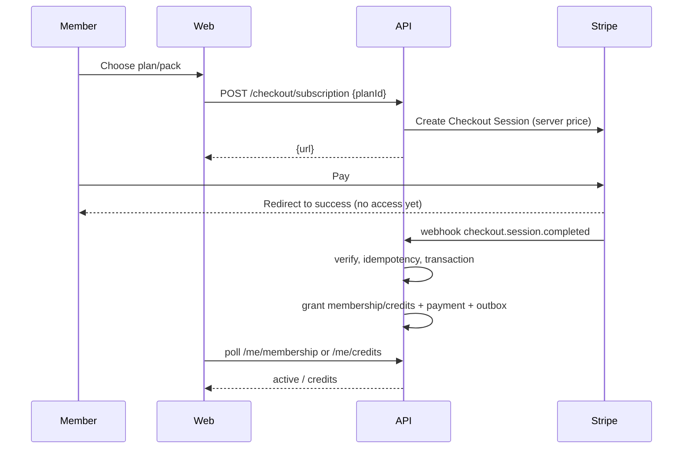

# 03 — API Surface

## Conventions

- Base: `https://api.example.com`
- Domain routes: `/api/v1/*`; auth: `/api/auth/*`; webhooks: `/api/webhooks/*`.
- JSON only. All requests/responses validated by shared Zod schemas.
- Auth: Better Auth session cookie (`HttpOnly`, `Secure`, `SameSite=Lax`).
  `credentials: "include"` from the web app. No bearer tokens in localStorage.
- Email verification is required before booking or checkout; browsing and
  lead/contact forms remain public.
- Dates: ISO 8601 UTC in transit (`2026-11-02T14:30:00.000Z`). Objects that
  need display time include `timezone` and `localDate`/`localStartTime`.
- Money: integer `priceCents`, ISO currency. Never accept amounts from clients.
- IDs: 24-char ObjectId strings, validated.
- Lists: cursor pagination, `?limit=20&cursor=…`; response
  `{ data: [...], meta: { nextCursor, hasMore } }`.
- Single resource: `{ data: {...} }`.
- Errors: `{ error: { code, message, details?, requestId } }`.
- Mutations that can be retried accept `Idempotency-Key` (booking, checkout,
  credit adjustments). Same key + body returns the stored response; same key +
  different body returns `422 IDEMPOTENCY_KEY_REUSED`.
- Rate limits return `429` with `Retry-After`.
- Empty success: `204` for deletes/cancels with no body; otherwise `200`.
- OpenAPI is generated from shared Zod schemas; `openapi.json` is committed and
  CI fails on drift. Swagger UI at `/api/docs` in non-production.

## Status codes

| Code | Use |
| --- | --- |
| 200 | Read/update success |
| 201 | Created (booking, invite, session, checkout record) |
| 204 | Cancelled/deleted, no body |
| 400 | Malformed request |
| 401 | No/invalid session |
| 403 | Role/2FA/entitlement denied |
| 404 | Not found (or hidden by role) |
| 409 | Conflict: full, duplicate, cutoff closed, invite used |
| 410 | Invite/token expired or already used |
| 422 | Validation / idempotency reuse |
| 429 | Rate limited |
| 500 | Unexpected; never leak internals |

Stable error codes include: `UNAUTHENTICATED`, `FORBIDDEN`, `TWO_FACTOR_REQUIRED`,
`MUST_CHANGE_PASSWORD`, `VALIDATION_ERROR`, `NOT_FOUND`, `ALREADY_BOOKED`,
`SESSION_FULL`, `SESSION_UNAVAILABLE`, `CANCELLATION_WINDOW_CLOSED`,
`NO_ENTITLEMENT`, `NO_CREDITS`, `INVITE_EXPIRED`, `INVITE_USED`,
`LAST_SUPERADMIN`, `IDEMPOTENCY_KEY_REUSED`, `RATE_LIMITED`,
`WEBHOOK_SIGNATURE_INVALID`.

## Permission matrix

| Capability | member | coach | admin | superadmin |
| --- | --- | --- | --- | --- |
| Public reads, lead/contact forms | ✅ | ✅ | ✅ | ✅ |
| Own profile/bookings/membership/credits | ✅ | ✅ | ✅ | ✅ |
| Book/cancel own session | ✅ | — | — | — |
| Own session roster + attendance | — | ✅ | ✅ | ✅ |
| All sessions/templates CRUD | — | — | ✅ | ✅ |
| Member search/status/notes/credits | — | — | ✅ | ✅ |
| Leads and contact inbox | — | — | ✅ | ✅ |
| Coach profiles + coach invites | — | — | ✅ | ✅ |
| Refunds | — | — | — | ✅ |
| Admin invites/roles/suspension | — | — | — | ✅ |
| Billing plans/settings/reconcile | — | — | — | ✅ |
| System settings | — | — | — | ✅ |
| Audit log viewer/export | — | — | — | ✅ |
| Member data export/deletion | — | — | — | ✅ |

Enforced by `requireAuth`, `requireRole`, `requirePermission` and
`requirePrivileged2FA` middleware. Every route declares its policy; a test
iterates the matrix and asserts 401/403 for every disallowed role.

## Public endpoints

| Method | Path | Notes |
| --- | --- | --- |
| GET | `/api/health` | Liveness + DB ping; no auth; no secrets |
| GET | `/api/v1/public/location` | Name, address, hours, timezone |
| GET | `/api/v1/public/plans` | Active plans + public pack products |
| GET | `/api/v1/public/coaches` | Active coach profiles |
| GET | `/api/v1/public/sessions` | `from`, `to`, `discipline`, `coachId`, `locationId`; max 31 days; returns capacity/remaining |
| GET | `/api/v1/public/sessions/:id` | Detail; 404 if cancelled/hidden |
| POST | `/api/v1/public/leads` | Free-week/contact lead; rate limit + Turnstile |
| POST | `/api/v1/public/contact` | Contact message; rate limit + honeypot |

Public session responses never include member data. `remaining = capacity -
bookedCount`, floored at 0; waitlist count is exposed as a boolean/`waitlist`
flag, not a roster.

## Auth endpoints (Better Auth)

Mounted at `/api/auth/*`:

| Method | Path | Notes |
| --- | --- | --- |
| POST | `/sign-up/email` | Name, email, password; sends verification |
| POST | `/sign-in/email` | Sets session cookie; 2FA challenge if enabled |
| POST | `/sign-out` | Clears session |
| GET | `/session` | Current user + role + 2FA state |
| POST | `/verify-email` | Token from email |
| POST | `/forgot-password` | Generic response (no enumeration) |
| POST | `/reset-password` | Token + new password |
| GET | `/callback/google` | OAuth callback |
| POST | `/two-factor/enable` | TOTP secret + QR URI |
| POST | `/two-factor/verify-totp` | Confirm enrollment / login challenge |
| POST | `/two-factor/disable` | Requires password + TOTP |
| POST | `/two-factor/generate-backup-codes` | One-time codes, hashed at rest |

App-specific auth routes:

| Method | Path | Notes |
| --- | --- | --- |
| POST | `/api/v1/auth/accept-invite` | Token + name + password; creates user, sets role, marks invite used, starts 2FA enrollment |
| POST | `/api/v1/auth/change-password` | Requires current password; clears `mustChangePassword` |
| POST | `/api/v1/auth/complete-2fa-setup` | Marks privileged onboarding complete after TOTP verified |
| GET | `/api/v1/auth/invite/:token` | Public metadata (email masked, role, expiry); no secrets |

`mustChangePassword` and missing 2FA are enforced by middleware: privileged
routes return `403 MUST_CHANGE_PASSWORD` or `403 TWO_FACTOR_REQUIRED` with a
`next` hint (`/change-password`, `/dashboard/setup-2fa`).

## Member endpoints

| Method | Path | Notes |
| --- | --- | --- |
| GET | `/api/v1/me` | Profile, role, membership summary, credit balance, 2FA state |
| PATCH | `/api/v1/me` | Name, phone, image only; never email/role/status |
| GET | `/api/v1/me/bookings` | `scope=upcoming|past`, cursor; includes session snapshot + waitlist position |
| POST | `/api/v1/sessions/:id/bookings` | Book or waitlist; `Idempotency-Key`; 201 |
| DELETE | `/api/v1/bookings/:id` | Cancel own booking; 204; 409 after cutoff |
| GET | `/api/v1/me/membership` | Plan, status, renewal, `accessUntil`, portal availability |
| POST | `/api/v1/me/billing/portal` | Returns Stripe Billing Portal URL |
| GET | `/api/v1/me/credits` | Active balances + ledger (cursor) |
| GET | `/api/v1/me/notifications` | Unread first; cursor |
| PATCH | `/api/v1/me/notifications/:id` | Mark read |
| POST | `/api/v1/checkout/subscription` | `{planId}`; server resolves Stripe Price; returns `{url}` |
| POST | `/api/v1/checkout/pack` | `{packId}`; server resolves Price; returns `{url}` |
| POST | `/api/v1/checkout/drop-in` | `{sessionId?}`; buys one credit; returns `{url}` |
| GET | `/api/v1/me/check-in-token` | Phase 5 stretch: short-lived signed QR token |

Booking response:

```json
{
  "data": {
    "bookingId": "665f…",
    "status": "booked",
    "session": { "id": "665e…", "startsAt": "2026-11-02T14:30:00.000Z",
                 "timezone": "America/Los_Angeles", "title": "Iron Strength" },
    "credit": { "purchaseId": "665d…", "remaining": 7 }
  }
}
```

Full session with waitlist:

```json
{ "data": { "bookingId": "…", "status": "waitlisted", "position": 3 } }
```

Cancellation cutoff error:

```json
{ "error": { "code": "CANCELLATION_WINDOW_CLOSED",
  "message": "Cancellation closed 12 hours before the session.",
  "details": { "cutoffAt": "2026-11-02T02:30:00.000Z" },
  "requestId": "req_…" } }
```

Checkout rules:
- The client sends only `planId`/`packId`/`sessionId`.
- The server creates a Stripe Customer if needed, resolves the Price, sets
  `client_reference_id = memberId`, metadata `{memberId, type, planId|packId}`,
  and `success_url = ${WEB_URL}/account/membership?checkout=success`.
- Access/credits are granted **only** by the webhook, never by the success page.
- The success page shows "Processing…" and polls `/me/membership` or
  `/me/credits` until the webhook lands (with a timeout and support link).

## Coach endpoints

| Method | Path | Notes |
| --- | --- | --- |
| GET | `/api/v1/coach/sessions` | Own sessions, `from`/`to`; default today → +14d |
| GET | `/api/v1/coach/sessions/:id/roster` | 404 if not own session |
| POST | `/api/v1/coach/sessions/:id/attendance` | `{memberId, status: attended|no_show}`; own session only |
| GET | `/api/v1/coach/members/:id` | Minimal: name, photo, emergency contact? no billing |

Coaches cannot see member email/phone unless the plan explicitly allows it;
default is name + photo + attendance status.

## Admin endpoints

| Method | Path | Notes |
| --- | --- | --- |
| GET | `/api/v1/admin/overview` | Today's sessions, bookings, waitlist, new leads; revenue only for superadmin |
| GET | `/api/v1/admin/members` | `q`, `status`, `planId`, `cursor`; email/name search |
| GET | `/api/v1/admin/members/:id` | Profile, membership, credits, recent bookings, notes |
| PATCH | `/api/v1/admin/members/:id` | Status/notes only; **never role**; audited |
| POST | `/api/v1/admin/members/:id/credits` | Grant/adjust credits; note required; audited |
| GET | `/api/v1/admin/sessions` | `from`, `to`, `coachId`, `status`; includes counts |
| POST | `/api/v1/admin/sessions` | One-off session; validates coach/time/capacity |
| PATCH | `/api/v1/admin/sessions/:id` | Capacity/coach/time; cannot drop capacity below booked |
| POST | `/api/v1/admin/sessions/:id/cancel` | Reason; cancels bookings, restores credits, emails |
| GET | `/api/v1/admin/sessions/:id/roster` | Booked + waitlist + attendance |
| POST | `/api/v1/admin/sessions/:id/attendance` | Mark attended/no-show/check-in |
| GET | `/api/v1/admin/class-templates` | List/archive |
| POST | `/api/v1/admin/class-templates` | Create + generate future sessions |
| PATCH | `/api/v1/admin/class-templates/:id` | Edit rule; future generation only |
| DELETE | `/api/v1/admin/class-templates/:id` | Archive; does not delete sessions |
| GET | `/api/v1/admin/leads` | Pipeline, cursor, status filter |
| PATCH | `/api/v1/admin/leads/:id` | Status, assignment, note; audited |
| GET | `/api/v1/admin/contact-messages` | Support inbox |
| PATCH | `/api/v1/admin/contact-messages/:id` | Read/replied/archived |
| GET | `/api/v1/admin/coaches` | Profiles + user status |
| POST | `/api/v1/admin/coach-invites` | Invite a coach; admin allowed, audited |
| PATCH | `/api/v1/admin/coaches/:userId` | Profile/bio/credentials/active |
| POST | `/api/v1/admin/coaches/:userId/deactivate` | Revokes coach access; sessions remain |

Admin cannot: invite/promote admins, change roles, view audit logs, edit
billing plans/settings, issue refunds, or export/delete members. Those return
`403` even if the UI is bypassed.

## Superadmin endpoints

| Method | Path | Notes |
| --- | --- | --- |
| GET | `/api/v1/admin/team` | Admins + pending invites |
| POST | `/api/v1/admin/team/invites` | `{email, role: "admin"}`; single-use 48h; audited |
| POST | `/api/v1/admin/team/invites/:id/resend` | Invalidates prior token; audited |
| POST | `/api/v1/admin/team/invites/:id/revoke` | Audited |
| PATCH | `/api/v1/admin/team/:userId` | Role/status; last-superadmin guard; revokes sessions |
| POST | `/api/v1/admin/team/:userId/reset-2fa` | Break-glass; audited; notifies user |
| GET | `/api/v1/admin/audit-logs` | Filters: actor, action, entity, from/to; cursor |
| GET | `/api/v1/admin/audit-logs/export` | CSV; audited |
| GET | `/api/v1/admin/settings` | Business settings |
| PATCH | `/api/v1/admin/settings` | Validated; audited; no secrets |
| GET | `/api/v1/admin/billing/plans` | Plans + Stripe price status |
| POST | `/api/v1/admin/billing/plans` | Create plan + Stripe product/price; audited |
| PATCH | `/api/v1/admin/billing/plans/:id` | Metadata/active; price changes create a new Price |
| GET | `/api/v1/admin/billing/payments` | Local mirror + status; cursor |
| POST | `/api/v1/admin/billing/refunds` | Stripe refund + local ledger; audited |
| POST | `/api/v1/admin/billing/reconcile` | Queue a Stripe reconciliation run; audited |
| GET | `/api/v1/admin/members/:id/export` | JSON/CSV export; audited |
| DELETE | `/api/v1/admin/members/:id` | Anonymize PII; preserve financial records; audited |

Role changes:
- `PATCH /admin/team/:userId` accepts `{role?, status?}` with a strict schema.
- Cannot change own role; cannot demote/suspend the last active superadmin.
- On success: update user, revoke all sessions, write audit `before/after`.
- Promoting to admin requires the target to have 2FA enabled (or forces
  enrollment on next login). Role change never copies a password.

## Webhook endpoints

### `POST /api/webhooks/stripe`

- Mounted **before** `express.json()` with `express.raw({type:"application/json"})`.
- Verify `Stripe-Signature` with `STRIPE_WEBHOOK_SECRET`; reject 400 on failure.
- Insert `stripeEvents` by `event.id`; duplicate → 200.
- Claim the event (`received|failed → processing` with a lock); process in a
  transaction; mark `processed`; return 200.
- On transient failure: mark `failed`, return 500 so Stripe retries. Stale
  `processing` locks (>5 min) are reclaimable.
- Never trust `success_url`, client metadata prices, or event order.

Handled events:

| Event | Action |
| --- | --- |
| `checkout.session.completed` | Subscription: link customer/subscription, set `incomplete` until invoice paid. Pack/drop-in: grant credits once, ledger, payment row |
| `customer.subscription.created` | Upsert membership, plan, period, status |
| `customer.subscription.updated` | Sync status/period/cancelAtPeriodEnd; do not regress on older events |
| `customer.subscription.deleted` | Set `current:false`, `accessUntil` as appropriate |
| `invoice.paid` | Extend period, mark payment paid, clear past_due grace |
| `invoice.payment_failed` | Set `past_due`, start grace, notify member |
| `charge.refunded` | Mark refund, revoke unused credits/refunded pack, audit |

Out-of-order protection: for subscription events, fetch the current
subscription from Stripe before writing, or compare `event.created`/period
ends and ignore older state. The reconciliation job is the backstop.

### Other webhooks

- `POST /api/webhooks/resend` (Phase 5): bounce/complaint suppression list.
  Verify the signing secret; never trust the payload otherwise.

## Key flows

### Book a class

```mermaid
sequenceDiagram
  participant M as Member
  participant W as Next.js
  participant A as Express
  participant D as MongoDB
  M->>W: Click "Book"
  W->>A: POST /sessions/:id/bookings (cookie, idempotency key)
  A->>A: requireAuth + entitlement
  A->>D: transaction: conditional bookedCount++ ; insert booking ; credit ledger
  alt capacity available
    D-->>A: committed
    A-->>W: 201 booked
  else full
    A->>D: transaction: waitlistCount++ ; insert waitlisted
    A-->>W: 201 waitlisted + position
  end
  A->>D: outbox booking-confirmed
  W-->>M: Confirmation + calendar link
```

### Stripe checkout → access



## OpenAPI and contracts

- `packages/shared/src/schemas` defines request/response schemas, including
  error envelopes and paginated wrappers.
- `backend/src/openapi.ts` registers them with `zod-openapi` (or the current
  generator) and emits `openapi.json`.
- `GET /api/openapi.json` serves the committed document; `/api/docs` renders
  Swagger UI only when `NODE_ENV !== "production"`.
- CI runs `npm run openapi:generate && git diff --exit-code openapi.json`.
- Frontend forms import the same schemas; API client types come from
  `@gym/shared` or the generated OpenAPI types. No handwritten duplicates.

## Pagination, search and sorting

- Cursor is an opaque base64 of `{createdAt, _id}` (or `{startsAt, _id}`);
  never expose raw offsets for large collections.
- Default limit 20, max 100.
- Admin member search: exact email first, then prefix name/email; do not use
  unbounded regex. Atlas Search is a later optimization.
- Audit logs: newest first, filter by actor/action/entity/date.
- Stable sort: primary field + `_id` tiebreaker.

## Caching and revalidation

- Public plans/coaches/location: `revalidate 3600` in Next.js; API sends
  `Cache-Control: public, s-maxage=300, stale-while-revalidate=600`.
- Public sessions: revalidate 60 seconds; no per-member data.
- Authenticated responses: `Cache-Control: private, no-store`.
- After admin mutations, revalidate the relevant public tags
  (`plans`, `coaches`, `sessions`) via a signed internal endpoint or Next.js
  `revalidateTag` from a server action. Keep this out of v1 if it adds
  complexity; 60-second staleness is acceptable.
